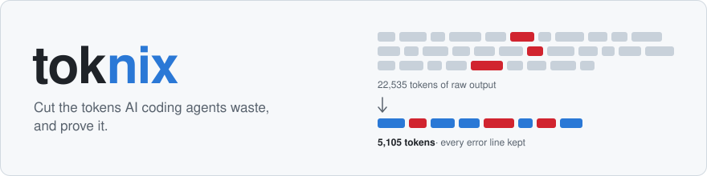
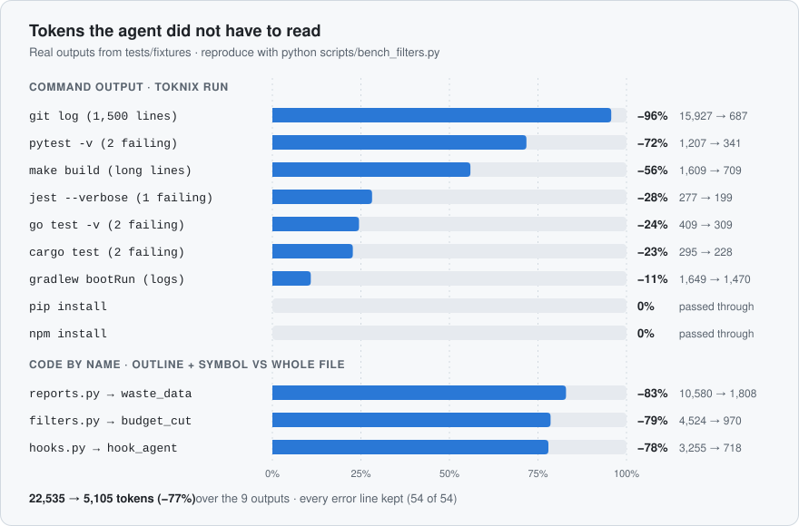
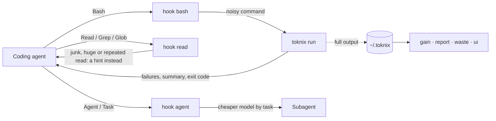

<p align="center">
  <picture>
    <source media="(prefers-color-scheme: dark)" srcset="docs/assets/banner-dark.svg">
    
  </picture>
</p>

<p align="center">
  <a href="https://github.com/lephus/toknix/actions/workflows/ci.yml"></a>
  <a href="https://github.com/lephus/toknix/tags"></a>
  
  
  
  <a href="LICENSE"></a>
</p>

<p align="center">
  <a href="#-quick-start">Quick start</a> ·
  <a href="#-benchmarks">Benchmarks</a> ·
  <a href="#-how-it-works">How it works</a> ·
  <a href="#-commands">Commands</a> ·
  <a href="#-configuration">Configuration</a> ·
  <a href="README.vi.md">Tiếng Việt</a>
</p>

---

**toknix** is a command-line tool for **Claude Code**, **Codex CLI** and **Gemini CLI**. It runs on Python ≥ 3.9
with the standard library only, and it does three things:

| | | |
|:---:|---|---|
| ✂️ | **Cuts waste** | noisy command output, reads of generated files, whole-file reads where one function would do |
| 📏 | **Measures what it cut** | from its own records and from the agent's transcripts, in tokens and in dollars |
| ✅ | **Proves quality did not drop** | A/B runs of a real agent on your own tasks, with a statistical verdict |

| ✂️ **−77%** | 🛡️ **54 / 54** | 🔎 **−78 to −83%** | ⚡ **0.19 s** | 📦 **0** |
|:---:|:---:|:---:|:---:|:---:|
| tokens on 9 real command outputs | error lines kept | reading one function instead of the whole file | `toknix refs` on a 2,000-file repo | runtime dependencies |

🔒 **Nothing leaves your machine.** Everything toknix keeps is in `~/.toknix/`.

## 🚀 Quick start

```bash
curl -fsSL https://raw.githubusercontent.com/lephus/toknix/main/install.sh | sh
```

On Windows (PowerShell, with Git for Windows installed):

```powershell
irm https://raw.githubusercontent.com/lephus/toknix/main/install.ps1 | iex
```

Then **restart Claude Code** and check the setup:

```bash
toknix doctor
```

From the next session on, noisy output reaches the agent filtered, with a footer that points to the full text:

```
[toknix: 84 → 37 lines; full output: toknix recall 851e91; exit 1]
```

See what it saved with `toknix gain`, or watch it live with `toknix ui`.

<details>
<summary><b>Installer options</b></summary>

The installer:

- uses `uv tool install` if you have [uv](https://docs.astral.sh/uv/). Otherwise it creates a private venv in
  `~/.toknix/venv`, so a system Python marked "externally managed" (PEP 668, e.g. Ubuntu 24.04) is never
  touched, and links `~/.local/bin/toknix` to it;
- puts `~/.local/bin` on PATH in your shell profile (`~/.zshrc`, `~/.bash_profile` or `~/.bashrc`,
  `config.fish`, `~/.profile`) when it is not there yet: two marked lines, never added twice. Open a new
  terminal afterwards, or run the `export` line the installer prints at the end;
- runs `toknix install` and then `toknix doctor`.

| Want to | Run |
|---|---|
| see what would happen | `curl -fsSL …/install.sh \| sh -s -- --dry-run` |
| install the command only, no hooks | `… \| sh -s -- --no-hooks` |
| leave my shell profile alone | `… \| sh -s -- --no-modify-path` |
| stay on a given release instead of `main` | `curl -fsSL …/install.sh \| TOKNIX_REF=v0.3.0 sh` |
| install without the script | `uv tool install git+https://github.com/lephus/toknix && toknix install` |

On Windows, `irm | iex` cannot pass options. Set `$env:TOKNIX_DRY_RUN = "1"` or `$env:TOKNIX_UNINSTALL = "1"`
first.

</details>

<details>
<summary><b>Update</b></summary>

Run the install command again:

```bash
curl -fsSL https://raw.githubusercontent.com/lephus/toknix/main/install.sh | sh
```

- It reinstalls toknix from the latest `main`, even when the version number did not change.
- Then `toknix install` points the hooks at the new install and replaces the rules block with the new one. It
  never adds a second copy.
- Check with `toknix --version` and `toknix doctor`. `doctor` also says when the rules block is older than the
  installed toknix.

</details>

<details>
<summary><b>Uninstall</b></summary>

Run the same script with `--uninstall`:

```bash
curl -fsSL https://raw.githubusercontent.com/lephus/toknix/main/install.sh | sh -s -- --uninstall
```

It does three things:

1. Runs `toknix uninstall`. This removes the hooks and the statusLine from `~/.claude/settings.json`, and the
   rules block from `~/.claude/CLAUDE.md` (and from `AGENTS.md` / `GEMINI.md` if they have one). Those files go
   back to exactly what they were before the install.
2. Removes the `toknix` command itself: `uv tool uninstall toknix`, or the `~/.toknix/venv` venv and the
   `~/.local/bin/toknix` link, and the two PATH lines the installer added to your shell profile.
3. Keeps your data in `~/.toknix` (stats, saved outputs). To delete it too: `rm -rf ~/.toknix`.

Then **restart Claude Code** so it stops loading the old hooks.

| Want to | Run |
|---|---|
| see what would be removed | `curl -fsSL …/install.sh \| sh -s -- --uninstall --dry-run` |
| turn toknix off in Claude Code but keep the command | `toknix uninstall` (turn it back on with `toknix install`) |
| uninstall on Windows (PowerShell) | `$env:TOKNIX_UNINSTALL = "1"; irm https://raw.githubusercontent.com/lephus/toknix/main/install.ps1 \| iex` |

</details>

<details>
<summary><b>What <code>toknix install</code> changes</b></summary>

`~/.claude/settings.json` (or `$CLAUDE_CONFIG_DIR/settings.json`):

| Hook | Command |
|---|---|
| PreToolUse `Bash` | `toknix hook bash` |
| PreToolUse `Read\|Grep\|Glob` | `toknix hook read` |
| PreToolUse `Agent\|Task` | `toknix hook agent` |
| SessionStart `compact\|clear` | `toknix hook session-start` |
| UserPromptSubmit | `toknix hook prompt`: warns you (not the model) when the context is over `context_budget` (1M) |

It also adds `statusLine` → `toknix statusline`, but only if you have no status line yet. All your other
settings stay as they are.

The rules block goes, between `<!-- toknix:begin v1 -->` and `<!-- toknix:end -->` markers, into
`~/.claude/CLAUDE.md`. It also goes into `~/.codex/AGENTS.md` and `~/.gemini/GEMINI.md`, but only if Codex or
Gemini CLI is installed.

Every change is backed up to `~/.toknix/backups/` first. `toknix uninstall` gives the files back byte for byte.

</details>

## 📊 Benchmarks

<p align="center">
  <picture>
    <source media="(prefers-color-scheme: dark)" srcset="docs/assets/benchmark-dark.svg">
    
  </picture>
</p>

The command outputs are the real outputs in [`tests/fixtures`](tests/fixtures), run through the same pipeline
as `toknix run`. The code reads compare a whole-file Read with `toknix outline <file>` plus
`toknix symbol <name>` on toknix's own source. Reproduce both with:

```bash
python scripts/bench_filters.py              # add --markdown for the tables below
```

<details>
<summary><b>Full numbers</b></summary>

| Command | Lines | Tokens | Saved | Error lines kept |
|---|---:|---:|---:|---:|
| `python -m pytest -v` | 82 → 36 | 1,207 → 341 | **−72%** | 11 / 11 |
| `npx jest --verbose` | 42 → 30 | 277 → 199 | **−28%** | 4 / 4 |
| `go test -v ./...` | 44 → 28 | 409 → 309 | **−24%** | 11 / 11 |
| `cargo test` | 41 → 30 | 295 → 228 | **−23%** | 5 / 5 |
| `npm install express typescript eslint` | 18 → 18 | 294 → 294 | 0% | 6 / 6 |
| `pip install requests rich` | 39 → 39 | 868 → 868 | 0% | 1 / 1 |
| `./gradlew bootRun` | 67 → 63 | 1,649 → 1,470 | **−11%** | 13 / 13 |
| `make build` | 17 → 18 | 1,609 → 709 | **−56%** | 3 / 3 |
| `git log` | 1,500 → 31 | 15,927 → 687 | **−96%** | 0 / 0 |
| **Total** | | **22,535 → 5,105** | **−77%** | **54 / 54** |

| Read | Whole file | outline + symbol | Saved |
|---|---:|---:|---:|
| `src/toknix/reports.py` → `waste_data` | 10,580 | 1,808 | **−83%** |
| `src/toknix/filters.py` → `budget_cut` | 4,524 | 970 | **−79%** |
| `src/toknix/hooks.py` → `hook_agent` | 3,255 | 718 | **−78%** |

| Speed and size | |
|---|---|
| `toknix symbol` / `toknix refs` on a generated 2,000-file repo | 0.14 s / 0.19 s (Python start-up included; CI fails at 2 s) |
| Rules block added to `CLAUDE.md` | 282 tokens |

</details>

> [!NOTE]
> - The token counts are toknix's own estimate (see [Known limitations](#-known-limitations)).
> - Outputs of 40 lines or fewer pass through untouched, which is why the two installs show 0%.
> - `git log` dominates the total. Taken one by one, test runs lose 23–72% and builds 11–56%.
> - The numbers on your own work come from `toknix gain` (what the filters cut) and from `toknix compare` (whether
>   a real agent got cheaper without failing more tasks).

## 🧩 How it works



### 🧹 Command output

The Bash hook rewrites noisy commands (tests, builds, installs, git, listings) to `toknix run -- '<cmd>'`.

- The agent gets the failures, the summary and the exit code. Passing tests, progress bars and download logs are
  dropped.
- **Error lines are never cut**, even when they alone go over the token budget.
- When something was cut, the output ends with `[toknix: 84 → 37 lines; full output: toknix recall 851e91; exit 1]`.
- `toknix recall <id>` prints the original byte for byte. `--grep` and `--lines` print just a part.
- `TOKNIX_RAW=1 <cmd>` is never rewritten.

### 🛡️ Read guard

Stops three kinds of read, and always says how to read instead:

- a whole generated, vendored or lock file (`node_modules/`, `package-lock.json`, `.min.js`…). Reading a slice
  with offset/limit is still allowed;
- a whole file over 800 lines. The hint suggests `toknix outline`;
- the third identical read of an unchanged file. This resets after `/compact` or `/clear`.

It also adds `head_limit: 200` to content Greps that have none.

### 🔎 Code by name

`toknix outline`, `symbol`, `refs` and `map` work on Python (exact, via `ast`) and on JS/TS, Go, Java, Rust,
PHP, Ruby, Dart, Kotlin and C# (regex, with strings and comments masked).

### 🧭 Subagent models

Subagents are about 70% of the cost of a Claude Code session. When one starts without a model, the agent hook
gives it a cheaper one by its task:

| Task | Model |
|---|---|
| Explore | Haiku |
| reading, searching, reviewing, implementing a task that is already written down | Sonnet |
| design, planning, debugging | yours, unchanged |

It never routes up, never overrides a model that you, the agent or an agent definition chose, and leaves forks,
Plan and plugin agents alone. `"route_subagents": false` turns it off.

### 📝 Rules block

282 tokens in `CLAUDE.md` that tell the agent to use these tools, to answer with the diff instead of a summary,
to Edit rather than rewrite files, and to keep its full reasoning for debugging, security and migrations.

## 🧰 Commands

| | Command | What it does |
|:---:|---|---|
| ✂️ | `toknix run -- "<cmd>"` | run a command, print filtered output, keep the original recallable; keeps the exit code |
| ✂️ | `toknix recall <id> [--grep RE] [--lines A:B]` | print the full output of a filtered run |
| 🔎 | `toknix outline <file>` | symbols of a file with line ranges (`L12-40  def foo(a, b)`) |
| 🔎 | `toknix symbol <name> [--kind K] [--path DIR]` | print a function or class (`Class.method` works) with line numbers |
| 🔎 | `toknix refs <name> [--path DIR]` | where a name is used in code (not in strings or comments), definition left out |
| 🔎 | `toknix map [DIR] [--budget 1500]` | the most used files and their top-level symbols, within a token budget |
| 📏 | `toknix gain [--days N] [--json]` | tokens saved by the filters and the read guard |
| 📏 | `toknix ui [--port N] [--no-open]` | a local, read-only page on `http://127.0.0.1:8765`: each filtered command with its original and filtered output side by side, read-guard denials, savings per day |
| 📏 | `toknix report [--days 7] [--json]` | token use from transcripts: ETU and $, cost by model, cache hit, output share, top sessions |
| 📏 | `toknix waste [--days 7] [--json]` | groups of waste (re-read cost, big outputs, junk reads, cache breaks, subagents by type and model…) with fixes |
| 📏 | `toknix context [--days 30] [--path DIR] [--json]` | instruction files, MCP servers and skills loaded every session, how often they are used, and the fixed overhead of every request, with what unused plugins, MCP servers and skills cost |
| 📏 | `toknix snapshot --label L [--days 7]` | save a report summary to compare later |
| 📏 | `toknix statusline` | Claude Code status line: `ctx 92k/1.0M ▯▯▯▯▯▯▯▯▯▯ · 1.2M ETU · saved ~84k ETU (6.5%) · /clear at 600k` |
| ✅ | `toknix bench tasks.json --label L [--rules FILE]` | A/B runs of a real agent in throwaway git worktrees |
| ✅ | `toknix compare A B [--json]` | compare two bench labels and give a verdict |
| 🔧 | `toknix install` / `uninstall` / `doctor` | set up, remove, and check the hooks and rules |
| 🔧 | `toknix init-project [--path DIR]` | deny Read of junk directories in the project's `.claude/settings.json`; write `.geminiignore` |

<details>
<summary><b>💲 ETU, the unit of cost</b></summary>

**ETU** is the unit used to compare costs: one input token of `etu_model` (Claude Opus 5.5, $4 per million
tokens). Each request is priced at its own model's list price: input, cache writes (5-minute and 1-hour), cache
reads and output. So ETU adds up across models and is proportional to dollars; reports show both. For Opus 5.5
that is:

```
input + 1.25 × 5-min cache write + 2 × 1-hour cache write + 0.05 × cache read + 5 × output
```

The dollars are API list prices: on a Pro or Max plan you do not pay per token, so read them as a comparison. A
model without a price (Codex, Gemini) uses `weights` and has no $; set them for those agents.

</details>

<details>
<summary><b>📏 Reading <code>toknix gain</code></b></summary>

```
toknix gain (all time)

Saved directly: 15.1k tokens (filters 15.1k, read guard 0)
With re-reads (estimate): 34.0k ETU ≈ $0.136 = direct × 2.25 (w_cw 1.25 + w_cr 0.05 × R̄ 20, claude-opus-5-5 prices)
  R̄ = 20 is the default value, not measured from transcripts yet

By filter kind
  kind          runs  cuts   saved  recalled  rate
  generic          3     2   15.1k         0    0%
```

- **Saved directly** is what the agent did not receive: original output minus filtered output, plus the files
  the read guard kept out. These are estimated tokens. Treat them as an estimate, not a bill.
- **With re-reads** is closer to what you pay. Tokens that enter the context are written to the cache once, then
  read again by every later request of the session.
  - R̄ is the median number of requests left after a Bash result, measured from your transcripts. Each result is
    priced at the model of the request that carried it.
  - Until there are transcripts, R̄ is 20 at Opus 5.5 prices, and the line says it is the default.
- **cuts / recalled / rate:** how often each filter cut output, and how often you or the agent then needed
  `toknix recall`.
  - Above 20% with 10 cuts or more, gain warns that the filter may cut too much. Please report the command when
    that happens.
- **Bash calls wrapped** is the share of Bash calls that went through `toknix run`.
- A run whose error lines alone exceed the token budget is counted as `error_overflow`. Those error lines are
  still all kept.

</details>

<details>
<summary><b>✅ Reading <code>toknix compare</code></b></summary>

`toknix bench` runs each task of a `tasks.json` several times, each time in a fresh `git worktree` that is
removed afterwards, even on timeout:

```json
{"repo": ".", "ref": "HEAD", "agent": "claude", "repeat": 3, "timeout": 900,
 "agent_args": ["--permission-mode", "acceptEdits"],
 "tasks": [{"id": "fix-cart", "prompt": "Fix the failing cart tests.", "check": "npm test"}]}
```

Run it once without toknix and once with it, then compare:

```
toknix compare baseline → v01 (12 vs 12 runs, 3 common tasks)

  pass rate             100% → 100%
  median ETU            37,151 → 24,606  -33.8% (95% CI -36.3% … -31.2%)
  median output tokens  2,972 → 1,712  -42.4% (95% CI -44.6% … -40.2%)
  ...
verdict: ACCEPT
output verdict: ACCEPT
```

| Verdict | When |
|---|---|
| 🟢 **ACCEPT** | the pass rate did not drop, median ETU fell by at least 10%, and the whole 95% confidence interval (bootstrap, 2,000 resamples) is below zero |
| 🔴 **REJECT** | the pass rate dropped, or B is not cheaper |
| 🟡 **INCONCLUSIVE** | B is cheaper, but not clearly: run more repeats |

The **output verdict** applies the same rule to output tokens only. It is how a rules variant
(`bench --rules variant.md`) is chosen.

Only tasks present in both labels are compared. The example above comes from the fake agent in the tests. Real
runs cost real money, which is why you run them.

</details>

## 🔧 Configuration

Settings live in `~/.toknix/config.json`. Only the keys you set override the defaults, which are in
[`src/toknix/config.py`](src/toknix/config.py). The ones you are most likely to change:

| Key | Default | Meaning |
|---|---|---|
| `max_lines`, `max_tokens` | 120, 3000 | budget of a filtered output (doubled when the command fails) |
| `wrap_programs` | test runners, package managers, git, docker… | commands the Bash hook rewrites |
| `guard_junk`, `guard_big_file_lines`, `guard_repeat_reads` | true, 800, 2 | read guard rules (`0` turns a rule off) |
| `grep_head_limit` | 200 | added to content Greps (`0` = off) |
| `context_window` | 1000000 | for the status line; 1M models are recognised |
| `etu_model` | `"claude-opus-5-5"` | 1 ETU = one input token of this model (`""`: every request uses `weights`) |
| `prices` | Anthropic list prices | $ per million tokens by model: input, 5-min cache write, 1-hour cache write, cache read, output. Your entries add to the defaults |
| `weights` | `[1, 1.25, 0.1, 5]` | ETU weights of a model without a price: input, cache write, cache read, output |
| `hook_permission` | `null` | see the warning below |
| `route_subagents` | true | the agent hook gives subagents a cheaper model by task (`false`: off) |
| `route_models` | `{"explore": "haiku", "read": "sonnet", "implement": "sonnet"}` | model for each kind of task (`null` leaves that kind alone); your entries add to the defaults |
| `route_agent_types` | `["general-purpose", "Explore"]` | subagent types the agent hook may change |

| Environment variable | Effect |
|---|---|
| `TOKNIX_RAW=1` | `toknix run` prints the raw output |
| `TOKNIX_DEBUG=1` | hooks print their errors to stderr. By default they never block the agent and stay silent |
| `TOKNIX_HOME` | where toknix keeps its data (default `~/.toknix`) |

> [!WARNING]
> **`hook_permission`.** By default the Bash hook only rewrites the command, and Claude Code then asks for
> permission as it would for the original command. Setting `"hook_permission": "allow"` makes the hook approve
> every command it rewrites. That includes `git push --force` and anything else your permission rules would have
> stopped. Leave it unset unless you know you want that. `"ask"` always asks.

## 🚧 Known limitations

- **Permission rules may not match rewritten commands.** A rule like `Bash(npm test:*)` may not match
  `toknix run -- 'npm test'`, so Claude Code can ask where it did not before. This has not been checked on Claude
  Code yet; it is check B of [docs/VERIFY.md](docs/VERIFY.md).
- **Token numbers are estimates.**
  - toknix counts characters per class: about 4 per token for text, 2 for hex/base64, 1.5 for non-ASCII.
  - It can calibrate these ratios from your transcripts. On the transcripts tested so far, the fit missed its
    quality bar (median error 21–25% against the 15% required), so the defaults are used.
  - `gain` therefore shows estimates. `report` and `waste` use the exact `usage` numbers of the transcripts.
- **The agent hook guesses the task from words.** It reads the subagent's description, then the start of its
  prompt (English and Vietnamese keywords); a task it cannot place keeps the main model. If a cheaper model makes
  subagents work longer, `waste` (8) shows more requests per agent; set `"route_subagents": false` to turn it off.
  No hook can change the main session's model.
- **Codex and Gemini CLI have no hooks yet.** They get the rules block, so the agent can call `toknix run` and
  `toknix outline` itself. Gemini transcripts are not read.
  - Subagent models: Gemini CLI already runs its read-only subagent (`codebase_investigator`) on Flash. toknix does
    not set one for Codex. Codex's only setting, `[agents] default_subagent_model` in `~/.codex/config.toml`
    (Codex 0.145 or later), applies to every subagent, including the ones that edit code, and a model that is not
    on your plan makes those spawns fail. Set it yourself if that suits you ([A9.1](docs/ALGORITHMS.md)).
- **Some Claude Code behaviour is still to be confirmed on a real session** ([docs/VERIFY.md](docs/VERIFY.md)):
  - whether `updatedInput` is applied without a permission decision;
  - whether Claude Code already skips repeated Reads;
  - whether a Grep cut by `head_limit` tells the agent it was cut;
  - whether the `init-project` deny rules match.
- **Windows** is supported through Git Bash, as Claude Code itself is. CI runs the tests and the installer on
  Windows, but no one has used toknix with Claude Code on Windows yet.
- **Outline:**
  - For languages other than Python it is regex-based. Minified code can confuse it.
  - Swift, C and C++ are not supported; `outline` prints the first 200 lines of those files.
  - `map` counts a name in strings and comments as a use.
- **The "Bash calls wrapped" share in `gain` is approximate.** It counts commands that hold `toknix run`, or whose
  output carries toknix's footer.

## 🛠️ Development

```bash
python -m unittest discover -s tests -v        # standard library only, no pytest needed
python scripts/bench_filters.py                # tokens cut on the fixtures, error lines kept
python scripts/bench_codesearch.py 2000        # symbol/refs on a generated 2,000-file repo
```

CI runs the 480+ tests and the code-search benchmark on Linux, macOS and Windows with Python 3.9 and 3.13, and
checks the install scripts with shellcheck and PSScriptAnalyzer.

| Document | What it holds |
|---|---|
| [docs/PLAN.md](docs/PLAN.md) | what is built, in what order |
| [docs/ALGORITHMS.md](docs/ALGORITHMS.md) | how each part works. It is the reference: when it and the code disagree, the document is fixed first |
| [docs/VERIFY.md](docs/VERIFY.md) | the checks on a real Claude Code session |
| [CHANGELOG.md](CHANGELOG.md) | what changed in each release |

**Publishing a new version:**

1. Raise `__version__` in `src/toknix/__init__.py` and add an entry to `CHANGELOG.md`.
2. Push to `main`.
3. Tag the release (`git tag v0.3.1 && git push origin v0.3.1`) so that it can be pinned.

## 📚 References

Both papers train a new tokenizer. toknix does not: you pay for the tokens your provider's tokenizer counts.

- Shi et al., *Counting and Min-Cost Encoding for Tokenization in Large Language Models* (CNF-MCE),
  [arXiv:2610.01127](https://arxiv.org/abs/2610.01127), 1 October 2026. It counts substrings across the whole
  corpus, keeps only the ones that are actually used, then picks the segmentation with the lowest total cost, and
  compares this with BPE. toknix takes two ideas from it: token cost depends on the kind of text, not on its length
  in characters (token estimates by character class, rewriting costly strings), and what matters is what gets
  used, not what appears often (filter recall, MCP servers and skills that are loaded but never called).
- Reif, Kaplan, Schwartz, *More Than Words: Compositional Tokenization for Efficient Language Models* (CoBPE),
  [arXiv:2610.05597](https://arxiv.org/abs/2610.05597), October 2026. It writes a short phrase as a base token
  plus modifiers, which makes sequences about 30% shorter than with BPE.

## 📄 License

MIT, see [LICENSE](LICENSE).
